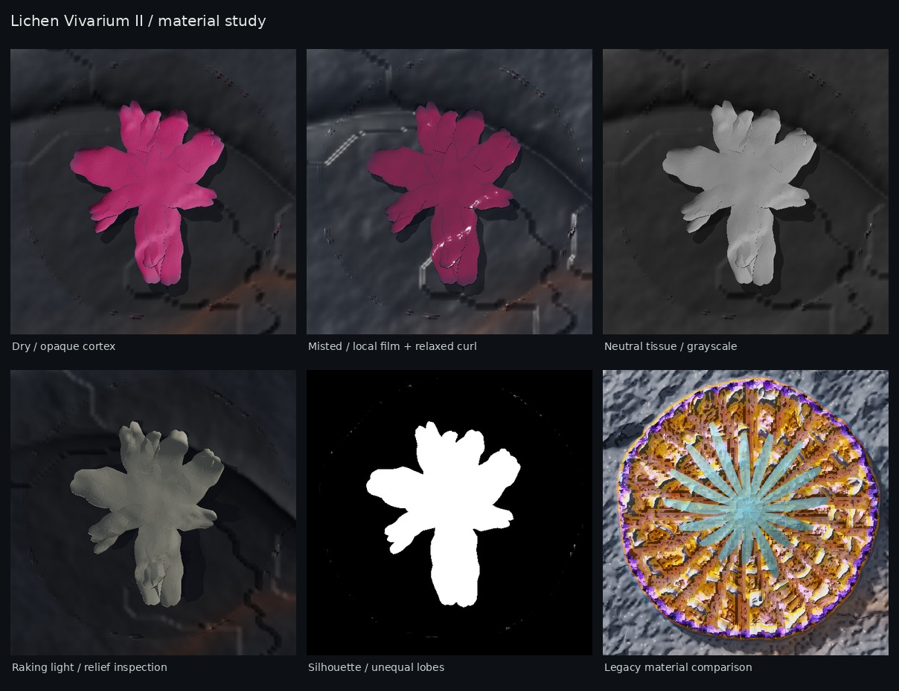

# A substantial foliose specimen

This implements the first rendering/anatomy slice from the five supplied guides. The target is a **fictional leathery foliose phenotype with impossible pigments**, not a calibrated species model. The existing standalone HTML/WebGL2 app, ecological simulation, palette vault and media export route remain in place.

## Try it

Serve the repository with `python -m http.server 8000`, open the app, then select **Optics/3D → Material study → Load study specimen**. This temporarily loads a paused mature specimen over the current rock. **Return to artwork** restores the captured biological, habitat, water and geological fields, module tick phases and settings. This is an in-memory comparison, not a disk project file. Custom palette edits made during the study are not rolled back.

Use **Mist tissue** and **Dry tissue** to inspect absorption, changing gloss and slower shape relaxation while growth remains paused. The canvas's Local Mist brush still changes only its local environmental water. Reference lighting removes optical polish; Exhibition view hides the interface and Escape returns to the studio. Turn **Coherent tissue material** off for the legacy comparison.

The study's rendering defaults and anatomical seed are fixed. Its substrate deliberately retains the current artwork's geological history. Fresh-page captures in `specimen-review/` use the default substrate.

## What changed

- A shared dielectric GGX material, palette sRGB decoding, scene-linear compositing and one final ACES/display transform. HDR uses RGBA16F when float rendering and blending are supported; otherwise a bounded linear RGBA8 target clips radiance above one before the display curve.
- A single CPU-derived half-float terrain texture (separate from the RGBA8 biology/hydration display fields) provides the visible height and mesh attachment height. Both passes use the same oblique projection, viewing direction and depth buffer. Painted foliose anatomy is suppressed only for the three colonies actually represented by physical meshes; other colonies keep the original heightfield rendering.
- Twelve unequal primary/daughter lobes form finite-thickness closed shells, with opaque cortex, a darker underside and distinct margins. Lite and Rich tessellate the same anatomical surfaces. Smooth deformation-aware normals and subtle tissue-bound cortical detail replace transparent, uniformly speckled ribbons.
- Environmental water, absorbed tissue water, surface film and shape response are distinct. Uptake, drying and deformation use different relaxation times. Frozen read-only export frames do not step weather.
- Material views expose neutral tissue, albedo, normals, roughness, local hydration, specular contribution and silhouette. Main/mesh/composite views isolate rendering contributions.
- A separate seeded biological random stream replaces nondeterministic spontaneous spore settlement. In-memory comparison restoration includes the RNG and biological/substrate/weathering clocks.
- Shader compile/link errors are reported; the pre-existing reserved GLSL identifier `patch`, which disabled mesh rendering in Chromium, is corrected.
- The scale bar follows the camera projection of an **artistic 50 mm substrate width**. This is a consistent scene-scale assumption, not a measured specimen.

## Evidence and verification



`specimen-review/manifest.json` records Chromium version, frame hashes, output size and measured render-call times. Captures are actual app output, not image generation. The browser harness freezes requestAnimationFrame and invokes the normal export rendering adapter at an exact state. It checks shader/runtime errors, nonempty output, repeat-frame identity, a visible wet/dry change, and pixel-identical capture/restore. The compositor is used by both preview and existing PNG/GIF/MP4 captures.

All 58 dependency-free checks pass. Run them with:

```sh
node --test --test-isolation=none tests/*.test.cjs
```

The optional real-browser study needs Playwright available to Node and a Chromium executable (override `CHROMIUM_PATH` if needed):

```sh
node tests/rendered-study.cjs http://127.0.0.1:8000
```

The software-rendered Chromium capture is not a mobile performance benchmark. A real 512² PNG download was checked for a valid PNG signature. Desktop and phone-sized Chromium controls were exercised separately; no physical iPhone/Safari test or end-to-end GIF/MP4 encoding test is claimed.

## Remaining work from the guides

This is a material/geometry foundation, not completion of the full multi-session playbook. Lobe identity is stable, but biological coverage still reveals seeded anatomy; persistent advancing lobe tips are not implemented. Daughter shells overlap their parent rather than forming a globally welded branching sheet. Shadows remain projected geometry plus existing heightfield shading; true lobe-to-lobe shadow maps are still needed. Finite depth provides occlusion but does not supply full mutual shadowing.

The new foliose shader prioritizes pigment under ordinary light. Existing fluorescence/iridescence controls continue to affect the legacy path; those specialized treatments still need a shared anatomical material contract. Pointer brushes target substrate coordinates, so precision picking of the top overlapping tissue under a tilted camera remains future work. Disk project saves, GPU context-loss restoration, authored timelines, additional phenotype-specific anatomy, and the existing GIF first-frame palette / MP4 fallback-state issues are also deferred.

References informing the supplied brief include [ANBG form and structure](https://www.anbg.gov.au/lichen/form-structure.html), [radial Xanthoparmelia organization](https://www.anbg.gov.au/lichen/xanthoparmelia.html), and [Filament's dielectric material model](https://google.github.io/filament/Filament.md.html). No reference photographs or licensed texture assets are redistributed.
